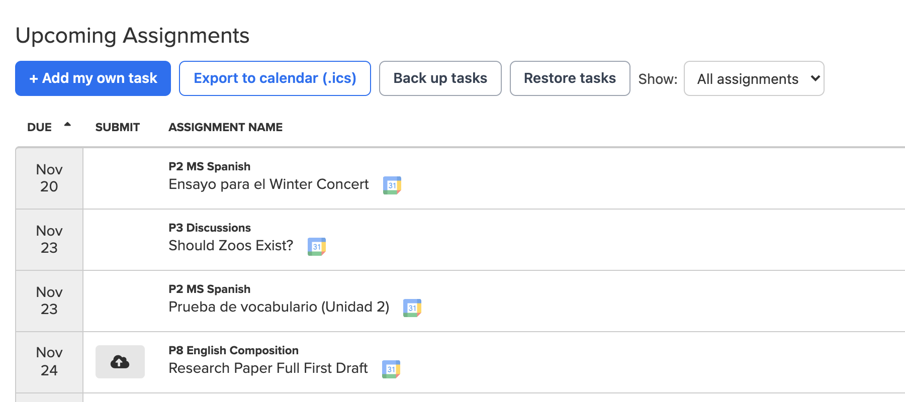
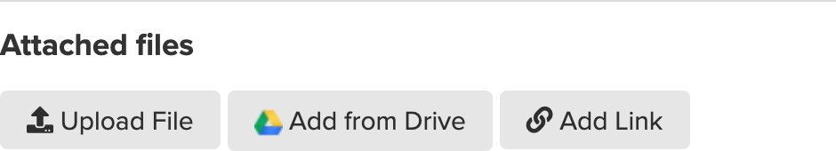
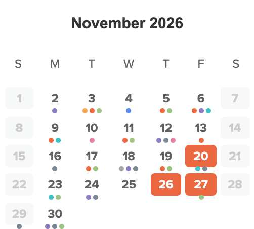

# Alma+ Custom Tasks

`Alma+ Custom Tasks` is an extension that adds convenient features for Seoul Academy students and technically everyone who uses Alma. Alma+ Custom Tasks allows students to add custom tasks to Alma's "todo" tab, so that any tasks or events that are not on Alma can be added. Also, the extension allows students to add assignments on Alma to their Google Calendar with a click of a button.

📖 **Full docs are in the [Alma+ Wiki](https://github.com/ians0316/alma-plus/wiki):** install and update, every feature, FAQ, troubleshooting, and the [Roadmap](https://github.com/ians0316/alma-plus/wiki/Roadmap) (also as a [project board](https://github.com/users/ians0316/projects/3)).

> [!IMPORTANT]
> **`Alma+` is an unofficial student project.** It is not made, supported, or approved by Alma or
> Seoul Academy. Alma can change its website at any time and break parts of the extension, so
> always double-check due dates in Alma itself.

> ⚠️ **Student accounts only:** Alma+ works only when you sign in to Alma with a student account. Parent and teacher accounts are not supported, and some features may not show or may not work as intended on them.

## How it works

`Alma+` runs on Alma's own pages (`*.getalma.com`) and adds to what's already there:

1. **Add:** press **+ Add my own task** on the To Do page or a class page, or click a day on the Calendar.
2. **See:** your tasks show up next to Alma's assignments, on the Today dashboard, and on the Calendar.
3. **Attach:** open any assignment or task to add files, links and notes.
4. **Finish:** press **Done** and the task moves to that class's Past Assignments with a green check.

```
Alma pages (*.getalma.com)
      |  your normal sign-in, no password
      v
   Alma+  (Chrome extension)
      |
      +--> on the page      tasks, Today dashboard, class tabs, Gradebook, Calendar dots
      +--> background.js    night-before reminder, new grade alerts (every 30 min)
      +--> chrome.storage   your tasks, notes, files, settings (this computer)
      +--> Alma Sync        your tasks to Notion + Google Calendar (optional)
```

## Setup

Download the GitHub repo (click "Code" then "Download Zip").

1. Unzip the zip file. This should create the extension folder.
2. Open `chrome://extensions` (Chrome/Brave) or `edge://extensions` (Edge).
3. Turn on Developer mode in the top right.
4. Click Load unpacked and select this project folder.
5. Open Alma's todo tab and you should be able to access the features this extension offers.

```
chrome://extensions           # or edge://extensions on Edge
Developer mode  -> on         # switch in the top right
Load unpacked   -> alma-plus  # pick the unzipped folder
reload ↻                      # after copying a new version over the old folder
```

Keep the extension folder where it is after loading it. Your custom tasks are stored in the browser under that folder's location, so moving, renaming or loading it from a different folder starts you with an empty task list. Use the backup button first if you ever need to move it.
To update, download the new version and copy its files over the old folder (same location), then click the reload icon on the extension's card in `chrome://extensions`. Do not remove the extension to update it: removing it deletes your saved tasks.

## iPad and Safari

`Alma+` also works in **Safari on iPad** (and iPhone and Mac), on the Alma website, through the
free **Userscripts** app. No app to build, nothing to re-install.

1. Install **Userscripts** from the App Store (free).
2. Open **Settings → Apps → Safari → Extensions → Userscripts**, turn it on, and allow it on `getalma.com`.
3. Open the Userscripts app once and pick a folder for scripts (iCloud Drive works).
4. In Safari, open the [Alma+ Safari script](https://raw.githubusercontent.com/ians0316/alma-plus/main/ipad/alma-plus.user.js), tap the puzzle icon in the address bar → **Userscripts** → **Install**.
5. Open Alma. The `Alma+` icon in Alma's top bar opens the settings.

```
Userscripts app     # free, App Store; runs alma-plus.user.js on getalma.com
alma-plus.user.js   # every Alma+ feature in one file, updated with each release
Alma+ icon (top bar) # settings menu, since Safari has no extension toolbar here
```

- **Everything on the Alma pages works:** your tasks, Today dashboard, Calendar dots, class tabs, Gradebook, Grade Calculator, GPA, files and notes.
- **Reminders and grade alerts** pop up inside Alma (top right) when you open it, instead of as iPad notifications. For alerts when Alma isn't open, use [Alma Sync](https://github.com/ians0316/alma-sync)'s Google Calendar.
- **Your tasks start empty on the iPad.** To bring them over: **Back up tasks** on the Mac, AirDrop the file, then **Restore tasks** on the iPad.
- Sending tasks to Notion and Google Calendar needs Alma Sync on a Mac.

## Using Alma+

```
To Do page      + Add my own task          # your own task, mixed in with Alma's
                calendar button            # add an assignment to Google Calendar
                Export to calendar (.ics)  # every upcoming assignment and task in one file
                Back up tasks / Restore    # save or load all tasks as a .json file
Overview        Due Today / Due Tomorrow   # plus Recently Updated Grades, New & Updated
Class page      Gradebook                  # every score as a colored box + Grade Calculator
Calendar        click a day                # everything that day, + Add my own task
Alma+ icon      Test                       # see the reminder or grade alert right now
```

Everything Alma+ adds can be turned off from the Alma+ icon in Chrome's toolbar. Your data is in
Chrome's storage on this computer; back it up with **Back up tasks** before moving the folder.

## What's new in v2.0

Everything the extension adds is built to look like Alma itself: same fonts, colors, buttons, and popups.

## Features

### Custom tasks

- `Add your own tasks` with `+ Add my own task`. They show in Upcoming Assignments looking just like Alma's.
- `Multi-day tasks`: add an end date and the task shows as a range (e.g. Nov 13–15).
- `Class pages` list each class's own tasks in its Upcoming block, with the class filled in when you add one there.
- `Done` moves a task into that class's Past Assignments with a green check; `Undo` brings it back.
- `Past tasks` leave the To Do page on their own after their date and go to Past Assignments, never to Missing.
- Tasks without a class stay on the To Do page, so they never disappear.
- `Task popup`: click a task's name for an Alma-style popup with its class, teacher (with Alma's message envelope), status, dates, priority, description and files.
- `Filter` by everything, due today, or due this week.
- `Back up and restore` all tasks with the JSON buttons (saved as `alma-plus-tasks-YYYY-MM-DD.json`).



### Attached files

- Every assignment and task popup gets an `Attached files` section laid out like Alma's "Submit your work here": `Upload File`, `Add from Drive` and `Add Link`.
- Rename or delete items; photos open in a viewer and PDFs in a new tab.
- Rows with attachments show 📎 and a count; click it to open the popup.
- After saving, Alma's own "Files Saved" message appears.



### My notes

- Every assignment popup has `My notes`: write a note (links become clickable), edit or delete it any time.
- Assignments with a note show a small note icon on their row.

### Today dashboard

Alma's Overview page gets `Due Today`, `Due Tomorrow` and `Recently Updated Grades` under your
schedule, in the same card style as Alma's schedule. Click an assignment to open Alma's popup.

Below them, `New & Updated Assignments` lists assignments teachers posted in the last 3 days
(green `New`) and ones whose due date or name changed (orange `Updated`, showing the old and new
due date). Each one shows when it was last updated (like "updated today 3:42 PM") and its grade, if it has one.


### Night-before reminder

Every night at `8:00 PM` (you can change the time), Chrome shows a notification listing the Alma
assignments and your own tasks due tomorrow. Click it to open the To Do page. Nothing due means no
notification. Turn it off, pick the time, or press `Test` in the `Alma+` settings menu.

### New grade alerts

When a teacher posts or changes a grade, Chrome shows a notification with the assignment, the grade
and the points, like "New grade: final draft — A (100%) · 100/100". Click it to open that class.
`Alma+` checks your class pages every 30 minutes while Chrome is open. Turn it off or press `Test`
in the `Alma+` settings menu.

### Calendar page

- Colored dots under each day with assignments or tasks, one color per class period.
- Hover a day to see them; click it for a popup with everything that day and `+ Add my own task` for that date.
- The Events list mixes them in under each month.
- The `official Seoul Academy 2026–2027 academic calendar` (breaks, closed days, shortened schedules) is shown alongside Alma's own events.



### Google Calendar

- A `calendar button` next to each upcoming assignment opens Google Calendar with an all-day event filled in (multi-day tasks cover every day). Press `Save` in Google to add it.
- `Export to calendar (.ics)` downloads every upcoming assignment and task as one file. In Google Calendar, go to `Settings → Import & export → Import`.

These are one-time copies: if an assignment changes, add it again. For automatic updates, use
[Alma Sync](#notion--google-calendar).

### Around Alma

- `Extra sidebar tabs`: My Classes, Assignments, Attendance and Report Cards in the left menu, built with Alma's own icons.
- `Top bar search and mail`: look people up in the Directory, or pick a teacher to open Alma's New Message window.
- `Rounded corners` on Alma's boxes, tables, menus and buttons, matching its Schedule cards.

### Class tabs

Each class page gets a row of tabs, like the teacher version of Alma: `Dashboard` (Alma's class page as usual), `Bulletin` (class announcements), `Attendance` (your attendance for just this class), and `Gradebook`. Teacher-only tabs (roster, curriculum, recommendations, settings, admin panel) are left out because Alma doesn't let students open them.

The `Gradebook` shows every assignment as a column and each score as a colored box: green for A, light green for B, yellow for C, red for D or F. Click a box to open the assignment. Pick a category, turn the colors off, or use `Add Assignment` to add your own task to the class.

In Alma's `Past Assignments` table, the `Updated` column also shows the time a grade was entered or changed, under the date (like "11/23/26" and "3:00 PM"), and so does `Last Updated` in the Assignment Details popup.

Under it, the `Grade Calculator` answers "what do I need on the next one?" Pick the next assignment's category and how many points it's out of, choose the grade you want, and it shows the score you need. Type a score in `What if I get` to see what your grade would become. It uses the class's category weights and points the same way Alma does.

### GPA

On the `My Classes` tab, a box above the class list shows your `GPA` on an unweighted `4.0` scale, calculated from the letter grades Alma shows (`A` = 4.0, `A-` = 3.7, `B+` = 3.3, and so on). Classes without a grade are skipped, and cocurricular, advisory and study hall classes are left out by default. Use the checkbox in a class's `Grade` column to include or leave it out. Your choices are saved in the browser.

## Settings

Click the Alma+ icon in Chrome's toolbar to turn each part on or off:

| Setting | What it controls |
|---|---|
| Today dashboard | Due Today, Due Tomorrow, Recently Updated Grades, and New & Updated Assignments on the Overview page |
| Night-before reminder | A notification of what's due tomorrow, at the time you pick (8:00 PM by default), with a **Test** button |
| New grade alerts | A notification when a grade is posted or changed, with a **Test** button |
| Calendar | Your work and the official school calendar on Alma's Calendar page |
| Extra tabs | The extra sidebar tabs and the top bar buttons |
| On the To Do page | Your own tasks in Upcoming Assignments |
| On class pages | Each class's tasks in its Upcoming list |
| Extra buttons | Export, Back up, Restore and Show next to "+ Add my own task" |
| Google Calendar button | The calendar button on assignments and tasks |
| My notes | Notes in assignment popups |
| In popups | Upload File, Add from Drive and Add Link |
| Paperclip counts | 📎 on rows with attached files |

The menu also shows how many tasks and files are saved and when tasks last synced.


## Notion & Google Calendar

Pair `Alma+` with **[Alma Sync](https://github.com/ians0316/alma-sync)** on your Mac and your tasks
show up in Notion and Google Calendar within seconds of adding or editing them. Run this once in
Alma Sync's `alma_sync` folder:

```sh
./install_task_bridge.sh
```

The settings menu shows when tasks last synced, with a **Sync now** button.

## Privacy

- Tasks, attached files and notes are stored **in this browser only** (Chrome `storage`). They stay on that computer unless you back them up.
- Files can be up to 25 MB each.
- Alma+ never asks for your Alma password; it reads Alma's pages with the sign-in you already have.
- The night-before reminder and new grade alerts read your To Do and class pages in the background with that same sign-in. The notification is made by Chrome on your computer.
- Besides Alma itself, the only place your data goes is Alma Sync on your own computer (your task list, if you set it up). The Google Calendar button just opens a pre-filled Google page; nothing is saved until you press Save.

## Files

Plain `Javascript`and `CSS`, no build step, no outside libraries. Each Alma page gets only the scripts it needs:

| Folder / file | What it does |
|---|---|
| `manifest.json` | Name, version, icons, and which Alma pages each script runs on |
| `content/` | `alma-plus.js`, `alma-plus.css`: custom tasks, task popup, add/edit window, filters, calendar tools, backup. `background.js`: hands your tasks to Alma Sync for Notion and Google Calendar, sends the night-before reminder, and checks for new grades |
| `files-and-notes/` | `materials.js`, `materials.css`: attached files, My notes, paperclip and note icons, Files Saved message |
| `calendar/` | `calendar.js`, `calendar.css`: your assignments and tasks on Alma's Calendar page. `official-calendar.js`: the official school calendar (update each school year). `dashboard.js`, `dashboard.css`: Today dashboard on the Overview page |
| `layout/` | `sidebar.js`: extra sidebar tabs. `topbar.js`, `topbar.css`: search and mail buttons in the top bar. `rounded.css`: rounded corners, crest, and fixed top bar across Alma. `icons/`: extension icons, the school crest, and the Google Calendar icon. `screenshots/`: pictures for this README |
| `gpa/` | `gpa.js`, `gpa.css`: GPA box and checkboxes on the Classes tab. `class-tabs.js`, `class-tabs.css`: class tabs, Gradebook, Grade Calculator, and class attendance on class pages |
| `settings/` | `popup.html`, `popup.css`, `popup.js`: the settings menu |

### Project layout

```
manifest.json                 Name, version, and which Alma pages each script runs on
content/
  alma-plus.js                Custom tasks, task popup, add/edit window, filters, backup
  alma-plus.css               Styles for the above, matching Alma
  background.js               Alma Sync hand-off, night-before reminder, grade alerts
files-and-notes/
  materials.js                Attached files, My notes, paperclips, update times in popups
calendar/
  dashboard.js                Today dashboard on Overview
  calendar.js                 Your work on Alma's Calendar page
  official-calendar.js        Official Seoul Academy calendar (update each school year)
gpa/
  class-tabs.js               Class tabs, Gradebook, Grade Calculator, class attendance
  gpa.js                      GPA box and checkboxes on My Classes
layout/
  sidebar.js                  Extra tabs in the left menu
  topbar.js                   Top bar search and mail buttons
  rounded.css                 Rounded corners and fixed top bar across Alma
  icons/  screenshots/        Pictures
settings/
  popup.html  popup.js        The Alma+ settings menu
```

## Roadmap

- [x] Custom tasks, attached files, notes, Calendar dots and the official school calendar
- [x] Today dashboard with New & Updated Assignments
- [x] Night-before reminder and new grade alerts
- [x] Gradebook tab, Grade Calculator and GPA
- [x] Exact update times everywhere
- [ ] Sync tasks across computers (coming in 3.0)
- [ ] Dark mode
- [ ] Search box on the To Do page
- [ ] This week view
- [ ] Test countdowns

→ Full list on the [Roadmap](https://github.com/ians0316/alma-plus/wiki/Roadmap) and the [project board](https://github.com/users/ians0316/projects/3).

<details>
<summary><b>Bugs fixed</b> (newest first)</summary>

Latest GitHub release: [**v2.17.0**](https://github.com/ians0316/alma-plus/releases/tag/v2.17.0). Latest extension version: **2.17.0**.

- **Grade alerts:** grades in classes with a Submit (cloud) button came up with no assignment name.
- **Today dashboard:** assignments with a Submit (cloud) button showed up with no name.
- **To Do:** your own tasks that fell between the same two Alma assignments showed in the order you made them, not by date.
- **Two Alma tabs:** if both saved a task at the same moment, one task could be lost. Saves now take turns.
- **Paperclip:** didn't show on assignments with a Submit button, even when they had a file attached.
- **Class attendance:** the Attendance tab on class pages came up empty.
- **Settings menu:** its icon was broken after the files were moved into folders.
- **Calendar page:** school events with a date range, like "Sep 24-25", didn't show.
- **Top bar mail button:** teacher names came up blank when the Classes page was in grid view.
- **New Message window:** the close (×) button was invisible.
- **Popups:** the fixed top bar covered a popup's title and close button.
- **Login page:** the fixed top bar hid the WELCOME message.
- **Speed:** class pages and the extension in general were slow (fixed in 2.0).

</details>

## Status

> [!IMPORTANT]
> **Status:** version 2.17.0, used day to day at Seoul Academy.
>
> - **Works today:** custom tasks, attached files, notes, Today dashboard, night-before reminder, new grade alerts, Calendar page, Google
>   Calendar buttons and .ics export, class tabs, Gradebook and Grade Calculator, GPA, extra tabs, settings menu, task sync through Alma Sync on macOS, and Safari on iPad through Userscripts.
> - **Limits:** updates are manual; data lives in one browser, and removing the extension deletes it (to update, click reload instead); Google Calendar buttons make one-time copies.
> - **Other schools:** most features work on any `getalma.com` site, but the official calendar is Seoul Academy's.

## Documentation

The [Alma+ Wiki](https://github.com/ians0316/alma-plus/wiki) is the main guide, with a page for every feature, plus [FAQ](https://github.com/ians0316/alma-plus/wiki/FAQ), [Troubleshooting](https://github.com/ians0316/alma-plus/wiki/Troubleshooting) and the [Roadmap](https://github.com/ians0316/alma-plus/wiki/Roadmap) of what's coming next. Track progress on the [Alma+ Roadmap board](https://github.com/users/ians0316/projects/3).

## Contributing

Want to help? See [CONTRIBUTING.md](.github/CONTRIBUTING.md) for how to report bugs, suggest features and make changes. Questions and ideas are welcome in [Discussions](https://github.com/ians0316/alma-plus/discussions).

## Report a bug

Email **`ian.shin0316@gmail.com` or at `ian.shin0316@seoulacademy.org`** 

<p align="center">
  <sub>Made by a Seoul Academy student, for Seoul Academy students. Not affiliated with Alma or Seoul Academy.</sub>
</p>
