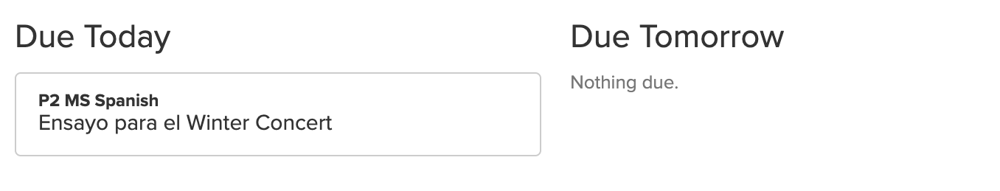
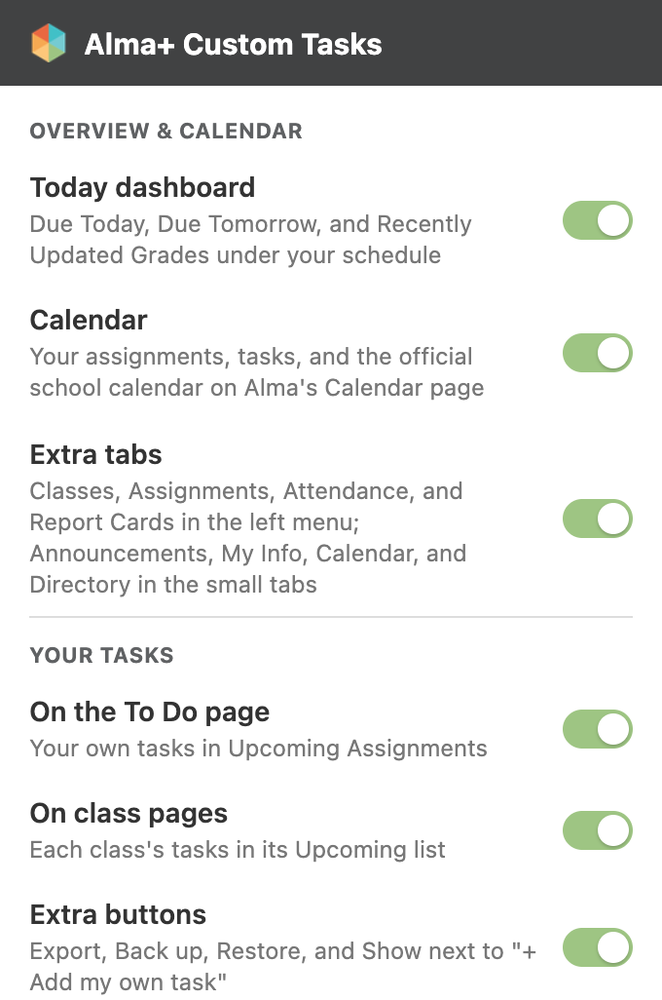

# Alma+ Custom Tasks

The Alma+ Custom Tasks is an extension that adds convenient features for Seoul Academy students and technically everyone who uses Alma. Alma+ Custom Tasks allows students to add custom tasks to Alma's "todo" tab, so that any tasks or events that are not on Alma can be added. Also, the extension allows students to add assignments on Alma to their Google Calendar with a click of a button.

> [!IMPORTANT]
> **Alma+ is an unofficial student project.** It is not made, supported, or approved by Alma or
> Seoul Academy. Alma can change its website at any time and break parts of the extension, so
> always double-check due dates in Alma itself.

> ⚠️ **Student accounts only:** Alma+ works only when you sign in to Alma with a student account. Parent and teacher accounts are not supported, and some features may not show or may not work as intended on them.

## How it works

Alma+ runs on Alma's own pages (`*.getalma.com`) and adds to what's already there:

1. **Add:** press **+ Add my own task** on the To Do page or a class page, or click a day on the Calendar.
2. **See:** your tasks show up next to Alma's assignments, on the Today dashboard, and on the Calendar.
3. **Attach:** open any assignment or task to add files, links and notes.
4. **Finish:** press **Done** and the task moves to that class's Past Assignments with a green check.

## Setup

Download the Github repo (click "Code" then "Download Zip").

1. Unzip the zip file. This should create the extension folder.
2. Open `chrome://extensions` (Chrome/Brave) or `edge://extensions` (Edge).
3. Turn on Developer mode in the top right.
4. Click Load unpacked and select this project folder.
5. Open Alma's todo tab and you should be able to access the features this extension offers.

Keep the extension folder where it is after loading it. Your custom tasks are stored in the browser under that folder's location, so moving, renaming or loading it from a different folder starts you with an empty task list. Use the backup button first if you ever need to move it.
To update, download the new version and copy its files over the old folder (same location), then click the reload icon on the extension's card in `chrome://extensions`. Do not remove the extension to update it: removing it deletes your saved tasks.

## What's new in 2.0

Everything the extension adds is built to look like Alma itself: same fonts, colors, buttons, and popups.

## Features

### Custom tasks

- **Add your own tasks** with **+ Add my own task**. They show in Upcoming Assignments looking just like Alma's.
- **Multi-day tasks:** add an end date and the task shows as a range (e.g. Nov 13–15).
- **Class pages** list each class's own tasks in its Upcoming block, with the class filled in when you add one there.
- **Done** moves a task into that class's Past Assignments with a green check; **Undo** brings it back.
- **Past tasks** leave the To Do page on their own after their date and go to Past Assignments, never to Missing.
- Tasks without a class stay on the To Do page, so they never disappear.
- **Task popup:** click a task's name for an Alma-style popup with its class, teacher (with Alma's message envelope), status, dates, priority, description and files.
- **Filter** by everything, due today, or due this week.
- **Back up and restore** all tasks with the JSON buttons.


### Attached files

- Every assignment and task popup gets an **Attached files** section laid out like Alma's "Submit your work here": **Upload File**, **Add from Drive** and **Add Link**.
- Rename or delete items; photos open in a viewer and PDFs in a new tab.
- Rows with attachments show 📎 and a count; click it to open the popup.
- After saving, Alma's own "Files Saved" message appears.


### My notes

- Every assignment popup has **My notes**: write a note (links become clickable), edit or delete it any time.
- Assignments with a note show a small note icon on their row.

### Today dashboard

Alma's Overview page gets **Due Today**, **Due Tomorrow** and **Recently Updated Grades** under your
schedule, in the same card style as Alma's schedule. Click an assignment to open Alma's popup.



### Calendar page

- Colored dots under each day with assignments or tasks, one color per class period.
- Hover a day to see them; click it for a popup with everything that day and **+ Add my own task** for that date.
- The Events list mixes them in under each month.
- The **official Seoul Academy 2026–2027 academic calendar** (breaks, closed days, shortened schedules) is shown alongside Alma's own events.


### Google Calendar

- A **calendar button** next to each upcoming assignment opens Google Calendar with an all-day event filled in (multi-day tasks cover every day). Press **Save** in Google to add it.
- **Export to calendar (.ics)** downloads every upcoming assignment and task as one file. In Google Calendar, go to **Settings → Import & export → Import**.

These are one-time copies: if an assignment changes, add it again. For automatic updates, use
[Alma Sync](#notion--google-calendar).

### Around Alma

- **Extra sidebar tabs:** Classes, Assignments, Attendance and Report Cards in the left menu, built with Alma's own icons.
- **Top bar search and mail:** look people up in the Directory, or pick a teacher to open Alma's New Message window.
- **Rounded corners** on Alma's boxes, tables, menus and buttons, matching its Schedule cards.

### Class tabs

Each class page gets a row of tabs, like the teacher version of Alma: **Dashboard** (Alma's class page as usual), **Bulletin** (class announcements), **Attendance** (your attendance for just this class), and **Gradebook**. Teacher-only tabs (roster, curriculum, recommendations, settings, admin panel) are left out because Alma doesn't let students open them.

The **Gradebook** shows every assignment as a column and each score as a colored box: green for A, light green for B, yellow for C, red for D or F. Click a box to open the assignment. Pick a category, turn the colors off, or use **Add Assignment** to add your own task to the class.

### GPA

On the Classes tab, a box above the class list shows your GPA on an unweighted 4.0 scale, calculated from the letter grades Alma shows (A = 4.0, A- = 3.7, B+ = 3.3, and so on). Classes without a grade are skipped, and cocurricular, advisory and study hall classes are left out by default. Use the checkbox in a class's Grade column to include or leave it out. Your choices are saved in the browser.

## Settings

Click the Alma+ icon in Chrome's toolbar to turn each part on or off:

| Setting | What it controls |
|---|---|
| Today dashboard | Due Today, Due Tomorrow and Recently Updated Grades on the Overview page |
| Calendar | Your work and the official school calendar on Alma's Calendar page |
| Extra tabs | The extra sidebar tabs and the top bar buttons |
| On the To Do page | Your own tasks in Upcoming Assignments |
| On class pages | Each class's tasks in its Upcoming list |
| Extra buttons | Export, Back up, Restore and Show next to "+ Add my own task" |
| Google Calendar button | The calendar button on assignments and tasks |
| My notes | Notes in assignment popups |
| In popups | Upload File, Add from Drive and Add Link |
| Paperclip counts | 📎 on rows with attached files |

The menu also shows how many tasks and files are saved and when tasks last synced.



## Notion & Google Calendar

Pair Alma+ with **[Alma Sync](https://github.com/ians0316/alma-sync)** on your Mac and your tasks
show up in Notion and Google Calendar within seconds of adding or editing them. Run this once in
Alma Sync's `alma_sync` folder:

```sh
./install_task_bridge.sh
```

The settings menu shows when tasks last synced, with a **Sync now** button.

## Privacy

- Tasks, attached files and notes are stored **in this browser only** (Chrome `storage`). They stay on that computer unless you back them up.
- Files can be up to 25 MB each.
- Alma+ never asks for your Alma password; it reads Alma's pages with the sign-in you already have.
- Besides Alma itself, the only place your data goes is Alma Sync on your own computer (your task list, if you set it up). The Google Calendar button just opens a pre-filled Google page; nothing is saved until you press Save.

## Files

Plain JavaScript and CSS, no build step, no outside libraries. Each Alma page gets only the scripts it needs:

| Folder / file | What it does |
|---|---|
| `manifest.json` | Name, version, icons, and which Alma pages each script runs on |
| `content/` | `alma-plus.js`, `alma-plus.css`: custom tasks, task popup, add/edit window, filters, calendar tools, backup. `background.js`: hands your tasks to Alma Sync for Notion and Google Calendar |
| `files-and-notes/` | `materials.js`, `materials.css`: attached files, My notes, paperclip and note icons, Files Saved message |
| `calendar/` | `calendar.js`, `calendar.css`: your assignments and tasks on Alma's Calendar page. `official-calendar.js`: the official school calendar (update each school year). `dashboard.js`, `dashboard.css`: Today dashboard on the Overview page |
| `layout/` | `sidebar.js`: extra sidebar tabs. `topbar.js`, `topbar.css`: search and mail buttons in the top bar. `rounded.css`: rounded corners, crest, and fixed top bar across Alma. `icons/`: extension icons, the school crest, and the Google Calendar icon. `screenshots/`: pictures for this README |
| `gpa/` | `gpa.js`, `gpa.css`: GPA box and checkboxes on the Classes tab. `class-tabs.js`, `class-tabs.css`: class tabs, Gradebook, and class attendance on class pages |
| `settings/` | `popup.html`, `popup.css`, `popup.js`: the settings menu |

## Bugs fixed

Newest first.

- **Today dashboard:** assignments with a Submit (cloud) button showed up with no name.
- **To Do:** your own tasks that fell between the same two Alma assignments showed in the order you made them, not by date.
- **Two Alma tabs:** if both saved a task at the same moment, one task could be lost. Saves now take turns.
- **Paperclip:** didn't show on assignments with a Submit button, even when they had a file attached.
- **Class attendance:** the Attendance tab on class pages came up empty.
- **Settings menu:** its icon was broken after the files were moved into folders.
- **Calendar page:** school events with a date range, like "Sep 24-25", didn't show.
- **Top bar mail button:** teacher names came up blank when the Classes page was in grid view.
- **New Message window:** the close (×) button was invisible.
- **Popups:** the fixed top bar covered a popup's title and close button.
- **Login page:** the fixed top bar hid the WELCOME message.
- **Speed:** class pages and the extension in general were slow (fixed in 2.0).

## Status

> [!IMPORTANT]
> **Status:** version 2.12.0, used day to day at Seoul Academy.
>
> - **Works today:** custom tasks, attached files, notes, Today dashboard, Calendar page, Google
>   Calendar buttons and .ics export, class tabs and Gradebook, GPA, extra tabs, settings menu, task sync through Alma Sync on macOS.
> - **Limits:** updates are manual; data lives in one browser, and removing the extension deletes it (to update, click reload instead); Google Calendar buttons make one-time copies.
> - **Other schools:** most features work on any `getalma.com` site, but the official calendar is Seoul Academy's.

## Contributing

Want to help? See [CONTRIBUTING.md](.github/CONTRIBUTING.md) for how to report bugs, suggest features and make changes.

## Report a bug

Email **ian.shin0316@gmail.com** 

<p align="center">
  <sub>Made by a Seoul Academy student, for Seoul Academy students. Not affiliated with Alma or Seoul Academy.</sub>
</p>
